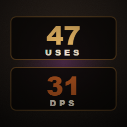

# RotDurability

[**Get it on Thunderstore**](https://thunderstore.io/c/grain-rot/p/Mentalize/RotDurability/)



Durability as **uses remaining** instead of a percentage, plus a **DPS** figure
on the damage row. A UE4SS mod for [Grain Rot](https://store.steampowered.com/app/4450620/).

The inspect panel shows durability as a percentage, so every weapon on a shop
shelf reads **100%** and there is no way to tell which one lasts longer. A knife
at 100% and a club at 100% are not remotely the same purchase.

```
Durability:   47 / 60 uses          instead of   Durability:   100%
Damage:       12-28  (30 dps)       instead of   Damage:       12-28
```

Now the comparison is obvious: 60 swings out of a club versus 15 out of a knife,
and the damage numbers tell you which one kills faster rather than just which
one hits harder.

---

## What it does

**Uses remaining.** Durability is stored as points, and every weapon spends a
different number of points per swing. A club with 300 points spending 5 a hit
gets 60 swings; a knife with 75 points also spending 5 gets 15. The panel shows
the number that actually matters.

**DPS.** Damage per second from the weapon's real attack cadence, not just its
damage range. A hard, slow club and a weak, fast blade land in very different
places once speed is accounted for.

Both update live and account for **enchantments** — bonus damage is read off
that specific item, so Blazing, Infested and Reinforced variants each show their
own DPS with no setup and no lookup tables.

**Demolition Power is deliberately excluded from DPS.** It only applies to
breakable scenery, so folding it in would flatter crowbars and mallets and make
the number useless for comparing weapons against enemies.

## How it knows

Per-use costs and attack speeds for the base game's weapons ship with the mod,
so the numbers are right the first time you look — on a fresh save, in a shop,
before buying anything.

Anything not covered is learned as you play:

| Source | Covers |
| --- | --- |
| Browsing a weapon in a **shop** | Exact per-use cost from the game's own item data |
| **Using** a weapon | Cost inferred from durability falling — catches dungeon loot shops never sell |
| **Swinging** a melee weapon | Attack cadence timed from real swings |

What it learns persists between sessions in two plain-text files under
`%LOCALAPPDATA%\Helden\Saved\`, both safe to delete; they refill on their own.

If a weapon's cost genuinely is not known yet, it shows honest durability
**points** rather than inventing a use count. A wrong number is worse than a
plain one.

## Notes

- **Client-side and cosmetic.** Only text in your own inspect panel is
  rewritten. No gameplay values change, nothing is sent to other players, and it
  is safe in multiplayer whether or not anyone else runs it.
- Furniture, character and treasure inspect panels are left untouched.
- Sustained-fire weapons like the Rot Burner drain durability continuously
  rather than per shot, so they keep showing points — "uses" would be a
  fabricated unit for them.

## Install

**Mod manager** — install from
[Thunderstore](https://thunderstore.io/c/grain-rot/p/Mentalize/RotDurability/).
It pulls in UE4SS for you.

**Manual** — requires [UE4SS](https://github.com/UE4SS-RE/RE-UE4SS) experimental
in `Helden/Binaries/Win64/`. Copy into that folder:

```
Mods/RotDurability/Scripts/main.lua
Mods/RotDurability/enabled.txt
UE4SS_Signatures/*.lua
```

The signatures are **required** on Grain Rot's UE 5.7 build — without them UE4SS
fails its scan on startup. A game update may invalidate them.

## Configuration

Optional — the `CFG` table at the top of `main.lua` holds every knob. The ones
worth knowing:

| Setting | Default | Effect |
| --- | --- | --- |
| `SHOW_DPS` | `true` | Set `false` to leave the damage row alone and keep only the durability change |
| `SHOW_PERCENT` | `false` | Set `true` to keep the original percentage alongside the count: `47 / 60 uses  78%` |
| `COST_BY_USE` | `true` | Set `false` to stop inferring costs from use, leaving only shop data and the bundled table |
| `PROBE_SHOP` | `true` | Set `false` to stop reading costs while browsing shops |

## License

MIT — see [LICENSE](LICENSE).
